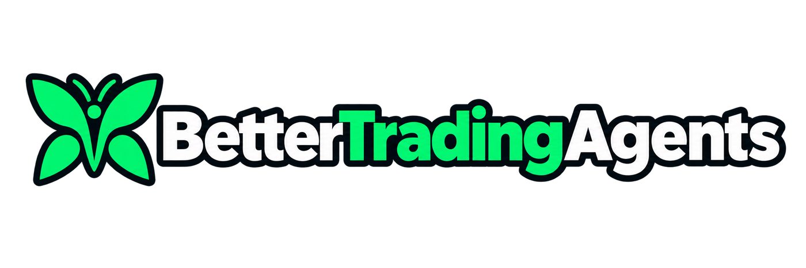
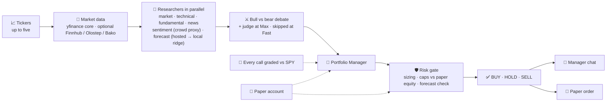

<div align="center">



**Real-time, multi-agent AI stock research and paper trading, on the OpenAI Agents SDK.**

[](https://www.python.org/)
[](https://fastapi.tiangolo.com/)
[](https://openai.github.io/openai-agents-python/)
[](https://docs.astral.sh/uv/)
[](#disclaimer)

[Highlights](#highlights) · [Quick start](#quick-start) · [Using the app](#using-the-app) · [Configuration](#configuration) · [API](#api) · [Backtesting](#backtesting) · [Wiki](https://github.com/kingabzpro/BetterTradingAgents/wiki)

</div>

---

Six analysts research each ticker in parallel (market regime, technicals, fundamentals,
news, sentiment, forecast), a bull/bear debate with a neutral judge sharpens the case,
and a risk-gated **BUY / HOLD / SELL** call comes back with sizing and the full
reasoning trail. Every call is later graded against what the market actually did.
Paper trading only. Research base: the
[TradingAgents framework](https://arxiv.org/abs/2412.20138); the
[wiki](https://github.com/kingabzpro/BetterTradingAgents/wiki) carries the details.


## Highlights

| | Feature | What it means |
|:---:|---|---|
| ⚡ | **Parallel by design** | Researchers, data fetches, and tickers run concurrently. |
| 🌍 | **Market regime** | A dedicated analyst reads S&P 500, Nasdaq, VIX, and the 10-year yield. |
| ⚔️ | **Real debate** | Bull vs bear, then a neutral judge cross-examines both at Max depth. |
| 🗣️ | **Social sentiment** | Reads Reddit and StockTwits; flags thin crowds as noise. |
| ⚖️ | **Risk-gated decisions** | Volatility-scaled sizing capped by per-ticker, invested, and cash limits. |
| 📜 | **Learns from its calls** | Every decision graded on return and alpha vs SPY; lessons feed the next run. |
| 💬 | **Chat with the manager** | Follow-up chat grounded in that run's research. |
| 🕶️ | **Incognito mode** | Market-only run: no account, no saving; download the report and it is gone. |
| 🧪 | **Walk-forward backtests** | Replay past dates with point-in-time data, graded vs SPY after costs. |
| ✅ | **Tested end to end** | 32 automated check groups plus a real-browser smoke; every setting round-trips exactly through the API and the web UI. |
| 🕘 | **Durable history** | Every run saved in SQLite, reopenable from the Runs page. |
| 📊 | **Real market data** | Finnhub, Olostep, yfinance; Bako (TimesFM) forecasts at the run's horizon, with a local ridge-model fallback. |
| 🧠 | **Model flexibility** | Any OpenAI-compatible endpoint (OpenAI, DeepSeek, OpenRouter, Z.AI, vLLM, Ollama), per role or per agent, with automatic fallback when a provider rejects an output format. |
| 🛡️ | **Autopilot with guard rails** | Scheduled paper sessions through the same risk gate and caps, plus a deployment budget, bear-market brake, and session webhook. |
| 🪶 | **No frontend build step** | Vanilla HTML, CSS, and JavaScript served by FastAPI. |

## How it works



## Quick start

You need [Python 3.12+](https://www.python.org/) and [uv](https://docs.astral.sh/uv/).

```bash
git clone https://github.com/kingabzpro/BetterTradingAgents.git
cd BetterTradingAgents
uv sync        # install dependencies
uv run setup   # arrow-key wizard: LLM + paper account live-tested, other keys format-checked
uv run app     # start the app on http://127.0.0.1:8000
```

> [!TIP]
> No LLM key yet? Leave `LLM_API_KEY` empty and everything runs in clearly
> labeled mock mode on live market data. The reverse works too: with only an
> LLM key, every agent still gets real input (yfinance plus deterministic
> Python math). The `uv run setup` wizard walks the first keys; everything
> is editable later on the Settings page, no restart needed.

## Using the app

| Screen | What it does |
|---|---|
| **Home** | Analyze up to 5 tickers with outlook and depth, or let **I Am Feeling Lucky** screen candidates. **Incognito** runs market-only and saves nothing. |
| **History** | Every run saved with a direct `?run=<id>` link; rerun or cancel from the live view. |
| **Trades** | Paper account: equity curve, positions, order lifecycle, return vs SPY, reconciliation drift banner, and the **Autopilot** card for scheduled sessions (notifications optional). |
| **Settings** | Every knob editable live; keys go to the OS keychain. The experimentation switch adds opt-in retired pages. |

Screen-by-screen walkthrough with screenshots: wiki [Usage](https://github.com/kingabzpro/BetterTradingAgents/wiki/Usage).

> [!TIP]
> It is cheap to run for real. With DeepSeek V4.1 Flash, one ticker costs
> about **$0.02 at Fast (3 agents), $0.04 at Pro (7 agents), $0.07 at Max
> (10 agents)** - the measured median of 88 real Max runs; news-heavy
> sessions run higher, and DeepSeek off-peak is half price. Mock mode is
> free, and an LLM key is the only paid prerequisite: every data provider
> has a free tier and yfinance needs no key.

## Configuration

Everything is editable in the app (Settings page); `.env` is the default layer. Key
sign-up links and what is optional: wiki [Providers](https://github.com/kingabzpro/BetterTradingAgents/wiki/Providers).

| Variable | Default | Purpose |
|---|---|---|
| `LLM_BASE_URL` | `https://api.openai.com/v1` | Any OpenAI-compatible endpoint: OpenAI, DeepSeek, OpenRouter, Z.AI, vLLM, Ollama... |
| `LLM_API_KEY` | Not set | Enables the LLM agents; without it, mock mode |
| `LLM_MODEL` | `gpt-6-luna` | Model for every role without an override |
| `FINNHUB_API_KEY` | Not set | Fundamentals and news (yfinance fallback) |
| `OLOSTEP_API_KEY` | Not set | Web search + scraping for news, and social sentiment (recommended); without it, news falls back to any other configured search key, then yfinance |
| `BAKO_API_KEY` | Not set | Forecast for the run's outlook horizon (TimesFM via Bako); without it, a local ridge model on yfinance closes |
| `ALPACA_API_KEY_ID` | Not set | Alpaca **paper** key; enables paper trading |
| `ALPACA_TRADING_ENABLED` | `0` | Kill switch for order submissions |
| `TERMINAL_LOGGING` | `0` | `1` shows the full INFO log trail and uvicorn request lines in the terminal |
| `APP_PORT` | `8000` | Port for `uv run app`; if busy, the next free port is used automatically |
| `AUTOMATION_*` | see `.env.example` | Autopilot schedule, candidates, confidence bar, budget, webhook |
| `WEBHOOK_URL` | Not set | One plain-text POST per finished autopilot session |

Everything else (per-role models, cost overrides, token and retry bounds, risk
caps, memory, backtest knobs):
wiki [Configuration](https://github.com/kingabzpro/BetterTradingAgents/wiki/Configuration).

## Security

- Keys live in the OS keychain ([keyring](https://pypi.org/project/keyring/)), never in the database or logs.
- Binds to `127.0.0.1` only; rejects non-loopback `Host` and cross-site `Origin` headers.
- Paper only: the Alpaca client hardcodes `paper=True`; no live-trading path exists.
- Found a vulnerability? Report it privately via [GitHub security advisories](https://github.com/kingabzpro/BetterTradingAgents/security/advisories/new) (see [SECURITY.md](SECURITY.md)); no public issues for exploitable findings.

## API

| Method | Route | Purpose |
|:---:|---|---|
| `POST` | `/api/analyze` | Start an analysis run |
| `GET` | `/api/runs/{run_id}` | Run status and results |
| `GET` | `/api/runs/{run_id}/events` | Live progress over SSE |
| `POST` | `/api/runs/{run_id}/chat` | Follow-up chat with the manager |
| `GET/POST` | `/api/settings` | Read and save settings (secrets masked) |
| `GET` | `/api/broker/account` | Paper account state |
| `POST` | `/api/broker/orders` | Place one paper order (explicit `confirm`) |
| `GET` | `/api/broker/sync` | Reconciliation and drift state |
| `POST` | `/api/automation/run` | Fire one autopilot session |
| `GET` | `/api/health` | Configuration and provider status |

Full schema and SSE catalog: wiki [API](https://github.com/kingabzpro/BetterTradingAgents/wiki/API).

## Backtesting

Replay past stock decisions and grade them against SPY after trading costs.
Mock mode is free and deterministic; add `--llm` for real agents with a cost
confirmation. No paper account is required.

```bash
uv run python -m app.backtest --tickers NVDA,AMD --start 2026-03-01 --end 2026-06-30
```

**Backtest snapshot** (reproducible mock replay: 6 tickers, 2025-06 to
2026-09, equal-weight accounting): the Fast profile compounded **+60.73%**
vs a momentum baseline's **+19.46%** on identical dates and costs; holdout
mean alpha **+3.45% per decision** (95% CI +0.7 to +6.6, the only tier
whose interval excludes zero).

**Every depth adds context:** Fast = 3 agents (price + forecast) · Pro = 7
(+ news, debate) · Max = 10 (+ sentiment, debate judge; in live replay the
judge cut drawdown by about a third). Returns do not separate the tiers at
honest sample sizes; full tables, intervals, and repro commands live in
the [Backtesting wiki](https://github.com/kingabzpro/BetterTradingAgents/wiki/Backtesting).

Reports and reproducibility manifests go to `backtests/`.

## Development

```bash
uv run test         # fast offline suite
uv run test all     # every group, including the browser smoke test
```

Check catalog: wiki [Testing](https://github.com/kingabzpro/BetterTradingAgents/wiki/Testing);
module walkthrough: [Architecture](https://github.com/kingabzpro/BetterTradingAgents/wiki/Architecture).

## Roadmap

The plan, shipped status, and research anchors live in the wiki's
[Roadmap](https://github.com/kingabzpro/BetterTradingAgents/wiki/Roadmap) page.

## Disclaimer

> [!WARNING]
> BetterTradingAgents is an educational project, not investment advice. The portfolio is simulated;
> nothing in this project executes real trades.

An improved and streamlined implementation inspired by
[TradingAgents](https://github.com/TauricResearch/TradingAgents). Licensed under
[MIT](LICENSE).
