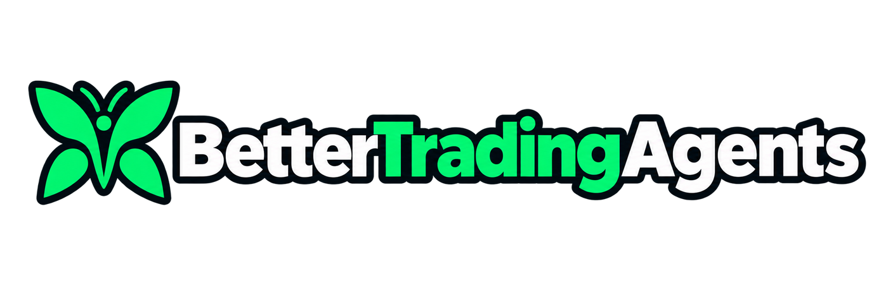
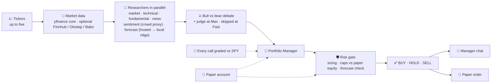

<div align="center">



**AI stock research and paper trading, powered by the OpenAI Agents SDK.**

[](https://www.python.org/)
[](https://fastapi.tiangolo.com/)

[](https://docs.astral.sh/uv/)
[](#disclaimer)

[Quick start](#quick-start) · [Highlights](#highlights) · [Head-to-head](#head-to-head-with-tradingagents) · [Using the app](#using-the-app) · [Configuration](#configuration) · [API](#api) · [Backtesting](#backtesting) · [Wiki](https://github.com/kingabzpro/BetterTradingAgents/wiki)

</div>

---

BetterTradingAgents researches stocks with a team of AI agents and presents a
**BUY / HOLD / SELL** decision with its reasoning and risk checks. Choose how
much research to run, ask the manager follow-up questions, and place simulated
orders through an Alpaca paper account. Completed calls can be graded against
subsequent market performance.

The app runs locally and supports OpenAI-compatible model providers. It is for
research and paper trading, and does not place live trades. It is inspired by the
[TradingAgents framework](https://arxiv.org/abs/2412.20138); the
[wiki](https://github.com/kingabzpro/BetterTradingAgents/wiki) has the details.


## Quick start

### Portable binaries (Python included)

Download and extract a desktop archive from [Releases](https://github.com/kingabzpro/BetterTradingAgents/releases/latest):

- **Windows x64:** `bettertradingagents-desktop-windows-x64.zip` — double-click `bettertradingagents.exe`.
- **Linux x64:** `bettertradingagents-desktop-linux-x64.tar.gz` — run `./bettertradingagents`.

The app opens in its own window and includes Python. Keep `_internal` beside the executable.
Add your provider URL, model, and API key in **Settings** to run real LLM analysis. Without a key, the app uses mock mode.
Values in a `.env` file beside the executable or in system environment variables take priority over Settings and require a restart when changed.
Windows requires the Microsoft Edge WebView2 runtime. Linux requires a graphical desktop and Qt system libraries (on Ubuntu:
`sudo apt install libxcb-cursor0 libxkbcommon-x11-0 libxcb-xinerama0 libxcb-icccm4 libxcb-keysyms1 libxcb-render-util0 libxcb-xkb1 libxcb-shape0 libegl1`).

Terminal-based downloads are also available. Extract the archive and run the matching command from the `bettertradingagents` folder:

| Platform | Archive | Command |
|---|---|---|
| Windows x64 | `bettertradingagents-windows-x64.zip` | `.\bettertradingagents.exe` |
| Linux x64 (Ubuntu 22.04 or newer) | `bettertradingagents-linux-x64.tar.gz` | `./bettertradingagents` |

On Windows, you can also double-click `bettertradingagents.exe` to start the
server in a terminal, then click the URL it prints.
Keep the terminal open while using the app.

Keep `_internal` beside the executable. Open the URL printed in the terminal
(usually `http://127.0.0.1:8000`) and add provider keys in **Settings**.

### Run from source

You need [Python 3.12+](https://www.python.org/) and [uv](https://docs.astral.sh/uv/).

```bash
git clone https://github.com/kingabzpro/BetterTradingAgents.git
cd BetterTradingAgents
uv sync        # install dependencies
uv run setup   # arrow-key wizard: LLM + paper account live-tested, other keys format-checked
uv run app     # start the app on http://127.0.0.1:8000
```

> [!TIP]
> No LLM key yet? Leave `LLM_API_KEY` empty and everything runs in clearly
> labeled mock mode on live market data. The reverse works too: with only an
> LLM key, every agent still gets real input (yfinance plus deterministic
> Python math). The `uv run setup` wizard walks the first keys; everything
> can also be configured in Settings. Fields set in `.env` or the environment
> must be changed at their source and require a restart.

## Highlights

| Feature | What it does |
|---|---|
| Parallel research | Researchers, data fetches, and tickers run concurrently. |
| Market regime | An analyst examines the S&P 500, Nasdaq, VIX, and 10-year yield. |
| Debate | Bull and bear agents argue the case; at Max depth, a judge reviews both sides. |
| Social sentiment | Uses Reddit and StockTwits results when available and treats thin crowds as noise. |
| Risk checks | Applies volatility-scaled sizing and per-ticker, invested, and cash limits. |
| Decision memory | Grades eligible decisions on return and alpha against SPY; lessons inform later runs. |
| Manager chat | Answers follow-up questions using the run's research. |
| Incognito mode | Runs market-only analysis without portfolio access or saved history; download the report before leaving. |
| Walk-forward backtests | Replays past dates with point-in-time data and grades results against SPY after costs. |
| Tests | Automated checks and a browser smoke test cover the API, Settings, and web UI. |
| Run history | Saves regular runs in SQLite so they can be reopened from the Runs page. |
| Market data | Uses Finnhub, Olostep, and yfinance; Bako (TimesFM) forecasts the selected horizon, with a local ridge-model fallback. |
| Model providers | Supports OpenAI-compatible endpoints (OpenAI, DeepSeek, OpenRouter, Z.AI, vLLM, Ollama) per role or agent, with fallback when a provider rejects an output format. |
| Autopilot | Schedules paper sessions with the same risk checks, a deployment budget, bear-market brake, and session webhook. |
| Frontend | Serves vanilla HTML, CSS, and JavaScript through FastAPI without a frontend build step. |

## Head-to-head with TradingAgents

Six shared NVDA / AMD / MSFT calls, same model, same endpoint, same grading. Measured 2026-10-28.

| | BetterTradingAgents (pro) | TradingAgents |
|---|---|---|
| Cost per decision | ~$0.011 | ~$0.069 |
| Time per decision | ~9 s | ~3 min |
| LLM calls per decision | 7 | ~16 |
| Net P&L, $10k per BUY | Same (-$633) | -$633 |
| Paper orders + risk caps | Yes | No ¹ |
| Backtest A/B, holdout, baselines | Yes | Grid scoring |
| Web app + guarded autopilot | Yes | - |
| Local-only guard, OS-keychain keys | Yes | - |
| LLM providers | OpenAI-compatible | Wider (native Anthropic, Google, Azure, Bedrock) |
| Crash-resume | No | Yes |

Both systems produced the same net -$633 on this small sample, while a plain momentum baseline performed better. BetterTradingAgents adds risk-capped paper orders, backtest controls, a web app, and autopilot. The upstream project supports more providers and crash-resume.

Full report: `backtests/report-vs-upstream-benchmark.md`.

¹ Upstream's own backtest docs: "not a portfolio simulator, and must not grow one" - orders do not exist there.

## How it works



## Using the app

| Screen | What it does |
|---|---|
| **Home** | Analyze up to 5 tickers with outlook and depth, or let **I Am Feeling Lucky** screen candidates. **Incognito** runs market-only and saves nothing. |
| **History** | Regular runs are saved with a direct `?run=<id>` link; rerun or cancel from the live view. |
| **Trades** | Paper account: equity curve, positions, order lifecycle, return vs SPY, reconciliation drift banner, and the **Autopilot** card for scheduled sessions (notifications optional). |
| **Settings** | Configure providers and app behavior. Unlocked fields apply live, and the experimentation switch adds opt-in retired pages. |

Screen-by-screen walkthrough with screenshots: wiki [Usage](https://github.com/kingabzpro/BetterTradingAgents/wiki/Usage).

> [!TIP]
> In the recorded DeepSeek V4.1 Flash benchmark, one ticker cost
> about **$0.02 at Fast (3 agents), $0.04 at Pro (7 agents), $0.07 at Max
> (10 agents)** - the measured median of 88 real Max runs; news-heavy
> sessions run higher, and DeepSeek off-peak is half price. Mock mode is
> free, and an LLM key is the only paid prerequisite: every data provider
> has a free tier and yfinance needs no key.

## Configuration

Configuration priority per configured field is `.env` → process environment →
saved Settings (OS keychain for keys when available) → defaults. Empty values allow saved fallbacks.
Fields set in `.env` or the environment are locked in Settings; edit them at their
source and restart, or remove/comment them to use Settings. Other changes apply live. Key
sign-up links and what is optional: wiki [Providers](https://github.com/kingabzpro/BetterTradingAgents/wiki/Providers).

| Variable | Default | Purpose |
|---|---|---|
| `LLM_BASE_URL` | `https://api.openai.com/v1` | Any OpenAI-compatible endpoint: OpenAI, DeepSeek, OpenRouter, Z.AI, vLLM, Ollama... |
| `LLM_API_KEY` | Not set | Enables the LLM agents; without it, mock mode |
| `LLM_MODEL` | `gpt-6-luna` | Model for every role without an override |
| `FINNHUB_API_KEY` | Not set | Fundamentals and news (yfinance fallback) |
| `OLOSTEP_API_KEY` | Not set | Web search + scraping for news, and social sentiment (recommended); without it, news falls back to any other configured search key, then yfinance |
| `BAKO_API_KEY` | Not set | Forecast for the run's outlook horizon (TimesFM via Bako); without it, a local ridge model on yfinance closes |
| `ALPACA_API_KEY_ID` | Not set | Alpaca **paper** key; enables paper trading |
| `ALPACA_TRADING_ENABLED` | `0` | Kill switch for order submissions |
| `TERMINAL_LOGGING` | `0` | `1` shows the full INFO log trail and uvicorn request lines in the terminal |
| `APP_PORT` | `8000` | Port for `uv run app`; if busy, the next free port is used automatically |
| `AUTOMATION_*` | see `.env.example` | Autopilot schedule, candidates, confidence bar, budget, webhook |
| `WEBHOOK_URL` | Not set | One plain-text POST per finished autopilot session |

Everything else (per-role models, cost overrides, token and retry bounds, risk
caps, memory, backtest knobs):
wiki [Configuration](https://github.com/kingabzpro/BetterTradingAgents/wiki/Configuration).

## Security

- Keys saved in Settings use the OS keychain ([keyring](https://pypi.org/project/keyring/)) when available. If it is unavailable, they are stored unencrypted in the local database and the app warns you.
- Binds to `127.0.0.1` only; rejects non-loopback `Host` and cross-site `Origin` headers.
- Paper only: the Alpaca client hardcodes `paper=True`; no live-trading path exists.
- Found a vulnerability? Report it privately via [GitHub security advisories](https://github.com/kingabzpro/BetterTradingAgents/security/advisories/new) (see [SECURITY.md](SECURITY.md)); no public issues for exploitable findings.

## API

| Method | Route | Purpose |
|:---:|---|---|
| `POST` | `/api/analyze` | Start an analysis run |
| `GET` | `/api/runs/{run_id}` | Run status and results |
| `GET` | `/api/runs/{run_id}/events` | Live progress over SSE |
| `POST` | `/api/runs/{run_id}/chat` | Follow-up chat with the manager |
| `GET/POST` | `/api/settings` | Read and save settings (secrets masked) |
| `GET` | `/api/broker/account` | Paper account state |
| `POST` | `/api/broker/orders` | Place one paper order (explicit `confirm`) |
| `GET` | `/api/broker/sync` | Reconciliation and drift state |
| `POST` | `/api/automation/run` | Fire one autopilot session |
| `GET` | `/api/health` | Configuration and provider status |

Full schema and SSE catalog: wiki [API](https://github.com/kingabzpro/BetterTradingAgents/wiki/API).

## Backtesting

Replay past stock decisions and grade them against SPY after trading costs.
Mock mode is free and deterministic; add `--llm` for real agents with a cost
confirmation. No paper account is required.

```bash
uv run python -m app.backtest --tickers NVDA,AMD --start 2026-03-01 --end 2026-06-30
```

**Backtest snapshot** (reproducible mock replay: 6 tickers, 2025-06 to
2026-09, equal-weight accounting): the Fast profile compounded **+60.73%**
vs a momentum baseline's **+19.46%** on identical dates and costs; holdout
mean alpha **+3.45% per decision** (95% CI +0.7 to +6.6, the only tier
whose interval excludes zero).

**Every depth adds context:** Fast = 3 agents (price + forecast) · Pro = 7
(+ news, debate) · Max = 10 (+ sentiment, debate judge; in live replay the
judge cut drawdown by about a third). Returns do not separate the tiers at
honest sample sizes; full tables, intervals, and repro commands live in
the [Backtesting wiki](https://github.com/kingabzpro/BetterTradingAgents/wiki/Backtesting).

> [!NOTE]
> When does Max return worse results? In our paired mock replay, Max cost
> **-2.08% per matched decision** vs Fast (95% CI -3.91 to -0.63, excludes
> zero); in live replay its mean alpha was lowest of the three tiers but
> statistically indistinguishable. This tracks independent research: a
> 20-year study across 100+ stocks found LLM investing strategies
> [statistically underperform the market](https://arxiv.org/abs/2505.07078),
> and a contamination-free benchmark found
> [most agents don't beat buy-and-hold](https://arxiv.org/abs/2510.02209):
> more agents buy context and risk control, not alpha.

Reports and reproducibility manifests go to `backtests/`.

## Development

```bash
uv run test         # fast offline suite
uv run test all     # every group, including the browser smoke test
```

Check catalog: wiki [Testing](https://github.com/kingabzpro/BetterTradingAgents/wiki/Testing);
module walkthrough: [Architecture](https://github.com/kingabzpro/BetterTradingAgents/wiki/Architecture).

## Roadmap

The plan, shipped status, and research anchors live in the wiki's
[Roadmap](https://github.com/kingabzpro/BetterTradingAgents/wiki/Roadmap) page.

## Disclaimer

> [!WARNING]
> BetterTradingAgents is an educational project, not investment advice. The portfolio is simulated;
> nothing in this project executes real trades.

An improved and streamlined implementation inspired by
[TradingAgents](https://github.com/TauricResearch/TradingAgents). Licensed under
[MIT](LICENSE).
